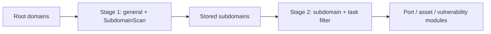

# ScopeSentry MCP guide

For users with an existing ScopeSentry deployment. Connect through Cursor or another MCP client; a local source checkout is unnecessary.

## 1. Preparation

### 1.1 Check connectivity

- Web interface: `http://<host>`
- MCP endpoint: `http://<host>/mcp`; use the actual `/mcp` address when a reverse/frontend proxy is present.

### 1.2 Create an API key

1. Sign in to the ScopeSentry Web interface.
2. Create a key on the **API Key** page or through the administrator-provided API.
3. Save the returned `ssk_...` string; it is shown only once.

### 1.3 Configure Cursor MCP

In Cursor → Settings → MCP, add a server:

```json
{
  "mcpServers": {
    "scopesentry": {
      "url": "http://<your-host>:8082/mcp",
      "headers": { "X-API-Key": "ssk_YOUR_KEY" }
    }
  }
}
```

Alternatively use `Authorization: Bearer ssk_YOUR_KEY`. Restart MCP or reload Cursor and confirm that tools such as `list_projects` and `list_assets` appear.

## 2. Tools

| Tool | Purpose |
| --- | --- |
| `list_projects` | Project tree grouped by tags, including IDs |
| `list_projects_data` | Paginated project list with name search |
| `get_project` | Project details |
| `create_project` | Create a project |
| `list_tasks` | Scan tasks |
| `get_task` | Task details |
| `list_scan_templates` | Scan templates |
| `get_scan_template` | Template details |
| `list_plugin_modules` | Scan pipeline module names |
| `list_plugins` | Available plugins, hashes, and default parameters |
| `create_scan_template` | Create a scan template |
| `create_scan_task` | Create a scan task |
| `list_assets` | Paginated asset queries |
| `count_assets` | Asset count (`/api/assets/common/total`) |
| `get_asset_detail` | Asset or finding details |
| `add_asset_tag` | Add an asset tag |
| `list_nodes` | Scan nodes |

Tool schemas are authoritative for parameters. `list_assets` and `count_assets` share search/filter syntax; read the `list_assets` description before querying. Use `count_assets` for totals rather than repeatedly paging through results.

## 3. Common workflows

### 3.1 Query assets by project

When the user/context identifies a project, prefer `filter.project` to avoid large, slow cross-project responses. A project filter is optional when no project is specified.

1. Obtain the project's ObjectID (`id` / `children[].value`) through `list_projects` or `list_projects_data`.
2. Pass the ID in `filter.project`, never the project's display name.

```json
{
  "asset_type": "asset",
  "pageIndex": 1,
  "pageSize": 20,
  "search": "domain=^example.com",
  "filter": { "project": ["<project-ObjectID>"] }
}
```

### 3.2 Create a scan task

1. Use `list_nodes` for online node names.
2. Obtain the template ObjectID through `list_scan_templates` or `create_scan_template`.
3. Call `create_scan_task`: `name` and `node` are required; `template` is a template ID, not a name.

Target sources match the Web interface:

| `targetSource` | Meaning | Required parameters |
| --- | --- | --- |
| `general` | Explicit targets | `target` |
| `project` | Targets from projects | `project` ObjectID array |
| `asset` | Search Web assets | `search`; optional `project`, `filter`, `targetNumber` |
| `RootDomain` | Search root domains | Same search options |
| `subdomain` | Search subdomains | Same search options |
| `UrlScan` | Search URL scan results | Same search options |
| `*Source`, such as `subdomainSource` | Create from selected/searched asset-page results | `search` for `targetTp=search`; `targetIds` for `targetTp=select` |

Direct root-domain scan:

```json
{
  "name": "example-subdomain-discovery",
  "node": ["node-1"],
  "template": "<template-ObjectID>",
  "targetSource": "general",
  "target": "example.com\nfoo.com",
  "project": ["<project-ObjectID>"]
}
```

Follow-up scan from subdomains, filtered by the previous task name:

```json
{
  "name": "example-ports-and-findings",
  "node": ["node-1"],
  "template": "<follow-up-template-ObjectID>",
  "targetSource": "subdomain",
  "search": "task==\"example-subdomain-discovery\"",
  "project": ["<project-ObjectID>"]
}
```

### 3.3 Complete root-domain reconnaissance in two stages

For complete reconnaissance from root domains, prefer two scans rather than one full pipeline. Distributed tasks are assigned per target. If one root domain is assigned to a node, its discovered subdomains also execute subsequent modules there, creating uneven load, slow scans, and errors.

1. **Subdomain discovery only**: `targetSource=general`, multiline root domains in `target`; enable only `SubdomainScan` and `SubdomainSecurity` (discovery/takeover). Wait for completion using `get_task`.
2. **Follow-up modules**: `targetSource=subdomain`, `search=task=="<stage-1-task-name>"`, optional project filter. Use port/asset/vulnerability modules, optionally excluding SubdomainScan. Subdomains are distributed as separate targets for better parallelism.

The Web subdomain page's task-name filter and Create task from subdomains action provide the same workflow.



### 3.4 Create a scan template

1. `list_plugin_modules` supplies module names.
2. `list_plugins`, optionally filtered by `module`, supplies plugin hashes and default `parameter`.
3. In `create_scan_template`, `modules` maps module names to arrays of plugin hashes.

## 4. Asset queries

`count_assets` accepts the same `asset_type`, `search`, and `filter` as `list_assets` and returns `{ "total": N }`, corresponding to `/api/assets/common/total`.

```json
{
  "asset_type": "subdomain",
  "search": "task==\"task-name\"",
  "filter": {"project": ["<project-ObjectID>"]}
}
```

For performance, use project filters when known and supported. On indexed fields, prefer exact `==` or a `^` prefix; broad `=` regex queries can be slow. Project filtering is not mandatory without project context.

### 4.1 Asset types

`asset`, `RootDomain`, `subdomain`, `app`, `mp`, `UrlScan`, `SensitiveResult`, `DirScanResult`, `crawler`, `vulnerability`, `PageMonitoring`, `IPAsset`, `SubdomainTakerResult`.

Aliases include `web`→asset, `vuln`→vulnerability, `ip`→IPAsset, and `url`→UrlScan.

### 4.2 Parameters

| Parameter | Meaning |
| --- | --- |
| `pageIndex` / `pageSize` | Pagination; defaults 1 / 20 |
| `search` | Search expression |
| `filter` | Exact-filter JSON |
| `sort` | Only UrlScan/DirScanResult support `length` sorting |
| `sid` | SensitiveResult rule name only |

`search` and `filter` can be combined.

### 4.3 Search expressions

The custom DSL is not SQL:

| Operator | Meaning | Index use | Example |
| --- | --- | --- | --- |
| `=` | Regex/partial match | No | `domain=example` |
| `==` | Exact equality | Yes | `port==443` |
| `!=` | Exclude | — | `port!="80"` |
| `&&` | AND | — | `domain==example.com && port==443` |
| `||` | OR | — | `title=admin || body=login` |

Fields such as domain/ip/port/title are indexed, but only `==` or a value beginning with `^` (for example `domain=^example.com`) can use the index. Ordinary `=` becomes an unindexed regex search.

Common fields across types: `tag`, `task` (task name), `rootDomain`. Do not put `project` in search; it is invalid and can cause errors with `&&`. Use `filter.project`.

| Asset type | Common search fields |
| --- | --- |
| asset | domain, ip, port, service, app, title, statuscode, icon, banner, type, body, header |
| RootDomain | domain, icp, company |
| subdomain | domain, ip, type, value |
| app | name, icp, company, category, description, url, apk |
| mp | name, icp, company, category, description, url |
| UrlScan | url, input, source, resultId, type |
| SensitiveResult | url, sname, body, info, md5 |
| DirScanResult | url, statuscode, redirect, length |
| vulnerability | url, vulname, matched, request, response, level |
| crawler | url, method, body, resultId |
| PageMonitoring | url, hash, diff, response |
| IPAsset | ip, domain, port, service, webServer, app |
| SubdomainTakerResult | domain, value, type, response |

Examples: `domain==www.example.com && port==443`, `domain=^example.com`, `ip==192.168.1.1`, `task=="task-name"`, `level==high` for vulnerability, and `statuscode==200` for DirScanResult. Use `title=admin` only when partial matching is needed, preferably with a project filter.

### 4.4 Exact filters

Filters are JSON objects. Multiple values for one key are OR; different keys are AND. Prefer `project` when context identifies a project and the asset type supports it.

| Key | Meaning / values |
| --- | --- |
| `project` | Project ObjectID from project-list tools |
| `task` | Task name from `list_tasks.name` |
| `port` | For example `"443"` |
| `service` | Service/protocol, such as `"https"` |
| `app` | Fingerprint, such as `"Nginx"` |
| `icon` | Icon hash |
| `statuscode` | HTTP status, mainly asset |
| `status` | UrlScan/DirScan HTTP status; finding/sensitive-data disposition |
| `level` | critical / high / medium / low / info |
| `type` | Type, such as DNS A/CNAME |
| `color` / `sname` | SensitiveResult rule color/name |
| `tags` | Tags |

| Asset type | Supported filter keys |
| --- | --- |
| asset | project, port, service, app, icon, statuscode, type, task, tags |
| RootDomain | project, tags |
| subdomain | project, type, task, tags |
| app / mp | project, tags |
| UrlScan / DirScanResult | status, tags |
| SensitiveResult | status, color, sname, tags |
| crawler | project, task, tags |
| vulnerability | project, level, status, task, tags |
| PageMonitoring / SubdomainTakerResult | tags |
| IPAsset | project, port, service, app |

```json
{
  "asset_type": "asset",
  "search": "domain=^example && port==443",
  "filter": {"project": ["<project-ObjectID>"]},
  "pageIndex": 1,
  "pageSize": 10
}
```

Do not supply project display names as IDs. Prefer exact/prefix queries on large tables. UrlScan HTTP codes use `filter.status`; DirScanResult also supports `search=statuscode==200`. For SensitiveResult rule names use `sname=rule-name` or `filter.sname`.

### 4.5 Sorting

Only UrlScan and DirScanResult support `{"length": "ascending"}`. Other types ignore sort and use default chronological ordering.

## 5. Scan module names

`TargetHandler`, `SubdomainScan`, `SubdomainSecurity`, `PortScanPreparation`, `PortScan`, `PortFingerprint`, `AssetMapping`, `AssetHandle`, `URLScan`, `WebCrawler`, `URLSecurity`, `DirScan`, `VulnerabilityScan`, `PassiveScan`.

## 6. Troubleshooting

| Symptom | Action |
| --- | --- |
| No MCP tools | Check URL, API key, and ScopeSentry availability |
| 401 / 403 | Recreate or replace the API key |
| Assets missing | Use ObjectID in `filter.project`; never project in search |
| Template/task creation fails | Use template ObjectID and online node names |
| Slow query | Add known project filter, use indexed exact/prefix queries, and reduce pageSize |
